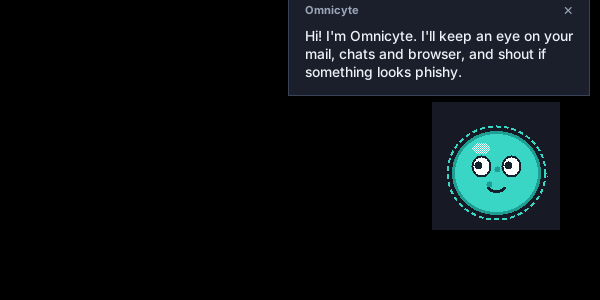
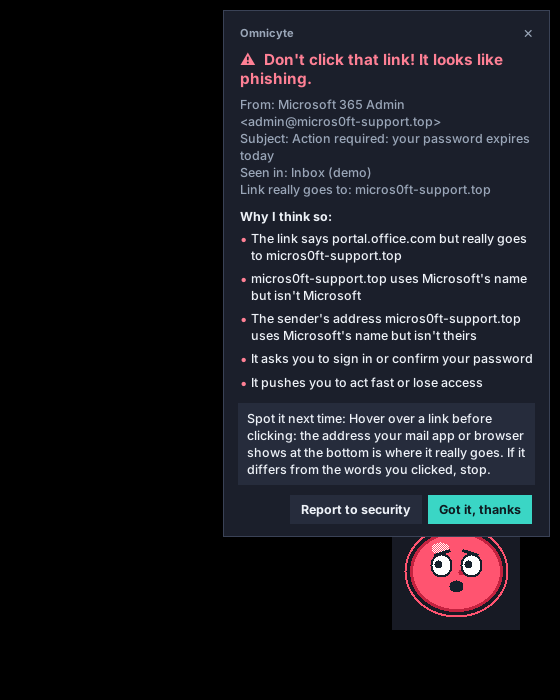
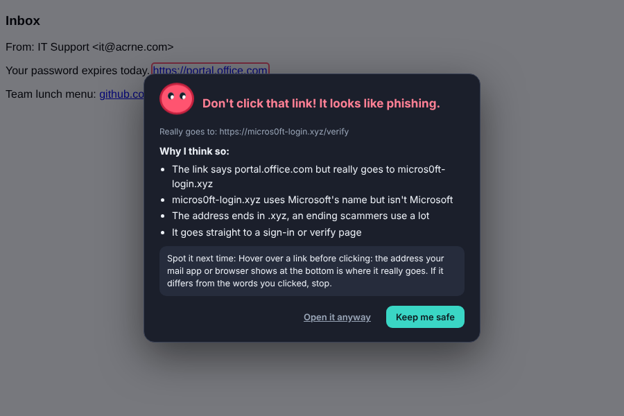

# Omnicyte

A little AI buddy that sits on each employee's desktop and protects their **mail, chats and
browser** from phishing. Most of the time it just lives there: it bobs, blinks, follows the
mouse with its eyes, wanders along the bottom of the screen and naps. When a malicious link,
a fake sender, a request for a password or a one-time code, or a shared secret shows up, it
turns red, jumps, and tells the person **not to click**. It shows the signals behind the
warning and a tip for spotting the same trick next time.

<p>


</p>

## Where it fits in the security stack

Omnicyte doesn't replace anything. It's the last layer, at the moment a person is about to act:

| Layer | Does | Omnicyte's part |
|---|---|---|
| Email gateway (Defender for Office 365, Proofpoint, Mimecast) | Blocks most bad mail before delivery | Catches what gets through. Unwraps Safe Links and URL Defense rewrites to judge the **real** destination, and counts the gateway's own spam marks as a signal |
| DNS / web filter (Umbrella, Zscaler, etc.) | Blocks known-bad sites | Catches brand-new lookalike domains that aren't on a block list yet, with no reputation feed needed |
| Security awareness training | Teaches the signs, a few times a year | Points out the same signs on the real message, at the moment it matters, so every alert is a small lesson |
| SOC / SIEM | Investigates | A metadata-only event log and a **Report to security** button feed them |

**Private by design.** Every decision is made on the employee's computer. No email, chat, page
or link is sent to Omnicyte's servers, or anywhere else. The event log never holds message text
or secrets, and it records links only by host name.

## What it watches

| Where | How |
|---|---|
| **Mail** | Watches inboxes over IMAP (Microsoft 365, Google Workspace, any IMAP server). It only peeks: it never marks mail as read, moves it or deletes it. Webmail (Outlook on the web, Gmail) is also covered by the browser extension. |
| **Chat** | Slack, Teams, Google Chat, WhatsApp Web, Discord and Telegram in the browser, through the extension. For desktop chat apps, the **clipboard watch** checks any link the moment it is copied. |
| **Browser** | The Chrome/Edge extension marks dangerous links on every page and **stops the click** with a warning. It also warns on a page that imitates a known brand, more strongly when that page asks for a password. |



## What it looks for

Every signal comes with a plain-language reason and a tip, so the alert also teaches.

- **Links:** lookalike domains (`micros0ft`, `rnicrosoft`, `gooogle`, letters from other
  alphabets), a brand name buried in someone else's domain (`paypal.com.secure-check.io`),
  near copies of **your own** domain (`acrne.com` for `acme.com`), link text that names one
  site while the link goes to another, `user@host` tricks, bare IP addresses, `javascript:` /
  `data:` links, program downloads, short links, throwaway domain endings, redirects to
  another site, and unencrypted sign-in pages.
- **Senders:** a display name that claims a brand or your company while the address is
  elsewhere, lookalike sender domains, and replies set to go to a different address.
- **Wording:** requests to confirm a password, share a one-time code or approve a sign-in,
  bank-detail changes, gift cards and urgent payments (business email compromise), and
  pressure to act fast.
- **Attachments:** programs and scripts, `invoice.pdf.exe` double extensions, HTML
  attachments (often fake sign-in forms) and macro documents.
- **Shared secrets:** passwords, AWS/GitHub/Slack/Stripe/Google/Anthropic/OpenAI keys,
  private keys and tokens pasted into chat or mail. These are shown only masked.

One strong sign alone (a lookalike domain, mismatched link text) is **danger**. Weaker signs
add up to **caution**. By default the buddy pops up only for danger, and the browser marks only
dangerous links.

## Keeping false alarms down

A buddy that cries wolf trains people to click past it, so Omnicyte is built to stay quiet about
ordinary mail:

- **Brand names are judged by context.** A disguised name (`micros0ft`, Cyrillic letters) or one
  dressed up as a domain (`paypal.com.evil.io`) is danger. A brand's plain name counts only next
  to the words phishers pair it with (`microsoft-login`, `dhl-parcel-redelivery`). Brand names
  that are everyday words (apple, amazon, outlook, teams, chase, zoom, slack, stripe…) never count
  on their own, so `apple-pie-recipes.com` and `economic-outlook.org` are fine. Fan, news and
  developer sites (`awesome-github.dev`) are fine too.
- **Your own spaces on SaaS platforms are recognised**: `acme.atlassian.net`,
  `acme.zendesk.com`, `stripe.statuspage.io`, `google.github.io`. So are the real domains of the
  brands it knows, including the ones they email from (`facebookmail.com`, `dropboxmail.com`,
  `echosign.com`).
- **Newsletter click trackers and short links** (SendGrid, Mailchimp, HubSpot, Marketo,
  `nyti.ms`…) never show the final address, so link text that differs from them is not held
  against them.
- **File and product names aren't sites**: link text like `report.pdf`, `README.md` or
  `Node.js` is not a claim about where the link goes.
- **Private network addresses** (intranet names, `192.168.x.x`, `10.x`, `.local`, `localhost`)
  are trusted: phishing comes from the internet.
- **Words alone never warn.** "Urgent", "verify your account", "your password will expire" and
  "invoice" are in plenty of real mail. They only count when something technical is wrong too: a
  lookalike sender, a bad link, a risky attachment, or a boss writing from a Gmail address. The
  one exception is a request to share a one-time code.
- **Display names**: a brand counts only when the name is just the brand plus service words
  ("Microsoft 365 Support"), so people and companies named Chase, Apple Valley Dental or
  "Salesforce Ben" are fine.
- **Code isn't a password**: `password = os.environ['DB_PASSWORD']`, `$DB_PASS`,
  `<your password>` and plain words are not flagged as shared secrets.
- **Downloads** are normal on websites. They only count in a message, and not when the sender
  links to their own site's installer.

`tests/test_omnicyte_false_alarms.py` holds over 200 everyday links, notifications, newsletters,
internal mails and chat messages that must all come out safe. `tests/test_omnicyte_detection.py`
holds the phishing that must still be caught. If a false alarm turns up in real use, add it to the
first file and make it pass without breaking the second.

## Install it

**Most people:** download the app for Windows, Mac or Linux and double-click it. No Python
needed. See **[INSTALL.md](INSTALL.md)**. The first time, a setup window asks for your company's
name, email domains and security team's address, and whether to start at login. Change them any
time from the buddy's right-click menu, under **Settings…**.

Every push builds the apps on real Windows, macOS and Linux machines. The
[Omnicyte app workflow](../.github/workflows/omnicyte.yml) runs the tests, builds with PyInstaller
(`packaging/omnicyte.spec`), starts each packaged app to run its self-test, and offers it as a
download. A tag like `omnicyte-v0.2.0` publishes a GitHub release.

## Run it from source

Omnicyte needs Python 3.11 or newer. It uses nothing outside the standard library. On Linux,
install Tk for the buddy (`sudo apt install python3-tk`).

```bash
cd omnicyte
```

```bash
python -m omnicyte --demo
```

`--demo` shows a pretend phishing email a few seconds after start. Drag the buddy anywhere.
Click it for a status. Right-click it to check a link, pause for an hour, turn the clipboard
watch on or off, or pair the browser extension.

The other commands:

```bash
python -m omnicyte check "https://micros0ft-login.xyz/verify"
```

```bash
python -m omnicyte check suspicious-message.eml
```

```bash
python -m omnicyte serve
```

`check` exits with 0 for safe, 1 for caution or 2 for danger, so it can be scripted.
`serve` runs without the buddy (for servers, or for testing the extension) and prints alerts.
`python -m omnicyte token` prints the extension's pairing code, and `python -m omnicyte policy`
shows the settings in force.

To install it as a command: `pip install ./omnicyte`, then run `omnicyte`.

### The browser extension

1. In Chrome or Edge, open `chrome://extensions` (or `edge://extensions`), turn on
   **Developer mode**, press **Load unpacked**, and choose the `omnicyte/extension` folder.
   For a company rollout, publish it privately in the Chrome Web Store or Edge Add-ons, and
   force-install it by policy (`ExtensionInstallForcelist`).
2. Right-click the buddy, choose **Pair the browser extension…**, copy the code, and paste it
   into the extension's popup.

The extension talks only to the Omnicyte app on the same computer (`127.0.0.1:47321`). The app
accepts requests only from a browser extension carrying the pairing code, so ordinary web
pages can't use it.

## Rolling it out (for IT)

Deploy a policy file with your MDM (Intune, Jamf, Group Policy):

| System | Path |
|---|---|
| Windows | `%PROGRAMDATA%\Omnicyte\policy.json` |
| macOS | `/Library/Application Support/Omnicyte/policy.json` |
| Linux | `/etc/omnicyte/policy.json` |

Or point `OMNICYTE_POLICY` at it. See [`policy.example.json`](policy.example.json):

| Field | Meaning |
|---|---|
| `org_name` | Shown in the extension |
| `org_domains` | Your own domains. Lookalikes of these are the strongest signal, and links to them are trusted |
| `trusted_domains` | Partners and services you use (payroll, vendor portals) |
| `report_to` | The address the **Report to security** button writes to. Leave it empty to hide the button |
| `event_log` | Where to write the event log (default `~/.omnicyte/events.jsonl`) |
| `alert_on` | `danger` (default) or `caution` to pop up for both |
| `clipboard_watch` | Check copied links. People may turn it off but never on against the policy |
| `allow_user_trust` | Let people mark a site as trusted from a caution alert |
| `mailboxes` | IMAP inboxes to watch: `host`, `user`, and `password_env`, the **name** of an environment variable holding the app password. Passwords are never written in Omnicyte's files |

**The event log** is one JSON object per line: time, computer, where it was seen, level, score,
the signal codes, the link's host, the sender's domain, and what the person did (`warned`,
`reported`, `dismissed`, `trusted`). Point your SIEM's file collector at it. Example:

```json
{"time": "2026-11-07T21:38:02Z", "product": "omnicyte", "version": "0.1.0", "computer": "LAPTOP-114", "source": "mail", "where": "you@acme.com", "level": "danger", "score": 160, "signals": ["brand-lookalike", "credential-request", "sender-lookalike", "text-mismatch", "urgency"], "link_host": "micros0ft-support.top", "sender_domain": "micros0ft-support.top", "action": "reported"}
```

## The code

| Path | What it is |
|---|---|
| `omnicyte/engine.py` | Judges a whole message: sender, wording, attachments, links, secrets |
| `omnicyte/urls.py` | Judges one link: unwrapping gateway rewrites, lookalikes, the tricks above |
| `omnicyte/signals.py` | Every signal's weight and its "spot it next time" tip |
| `omnicyte/brands.py` | The brands phishers imitate most, and their real domains |
| `omnicyte/creds.py` | Finding and masking shared secrets |
| `omnicyte/mail.py` | Reading `.eml` messages and watching inboxes over IMAP |
| `omnicyte/core.py` | Where every watcher reports: decides, logs, de-duplicates, alerts the buddy |
| `omnicyte/server.py` | The local service for the browser extension |
| `omnicyte/buddy.py` | The desktop buddy |
| `omnicyte/settings.py` | The first-run setup and Settings window |
| `omnicyte/autostart.py` | Starting at login on Windows, macOS and Linux |
| `omnicyte/ui.py`, `omnicyte/icon.py` | Fonts, colours, buttons and the icon |
| `launch.py`, `packaging/` | What the app is built from |
| `extension/` | The Chrome/Edge extension (Manifest V3) |
| `tests/` | Tests: `python -m pytest omnicyte/tests` from the repository root |

The product's web address is set in one place, `WEBSITE` in `omnicyte/policy.py` (or the
`OMNICYTE_WEBSITE` setting), and is used by the buddy's **About** link.

## Not done yet

- **Desktop chat apps** are covered only by the clipboard watch. Reading messages inside the
  Slack or Teams desktop apps would need their admin APIs (Slack Events API, Microsoft Graph
  for Teams), which is a server-side integration.
- **Microsoft 365 / Google sign-in without app passwords:** the inbox watcher uses IMAP.
  An admin-consented Microsoft Graph or Gmail API connector would avoid app passwords.
- **Code signing:** the apps aren't signed (Windows) or notarised (Apple) yet, so the first open
  shows a warning (INSTALL.md says how to get past it). Signing needs a code-signing certificate
  and an Apple Developer account in the company's name, then a signing step in the workflow.
- **The extension in the stores:** it's loaded by hand today. Publishing it in the Chrome Web
  Store and Edge Add-ons would let IT force-install it.
- **Intel Macs:** the Mac build is for Apple silicon. An Intel or universal build needs an Intel
  build machine.
- **An optional AI second opinion** for borderline messages. That would send message content to
  an AI provider, so it should be an organisation's explicit choice, off by default.
